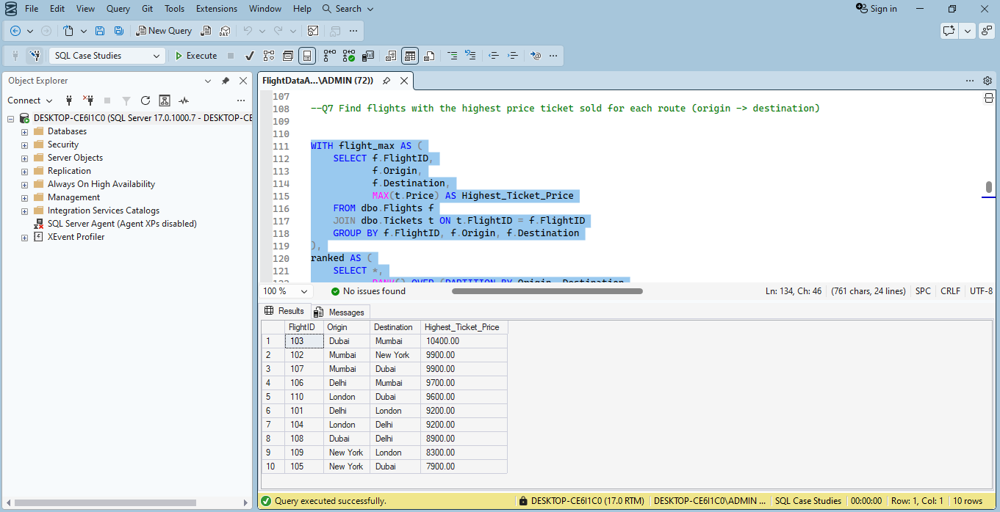
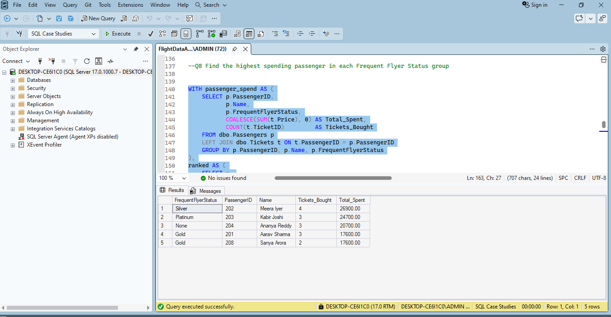
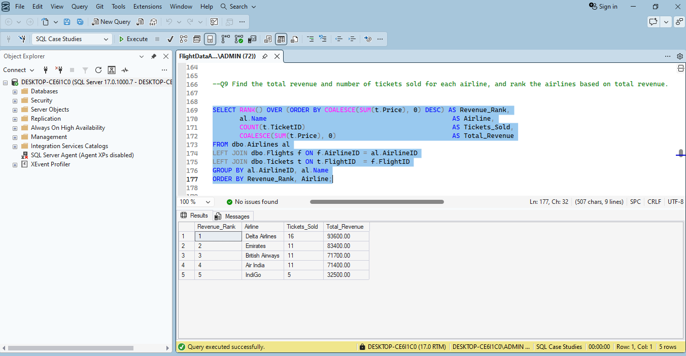
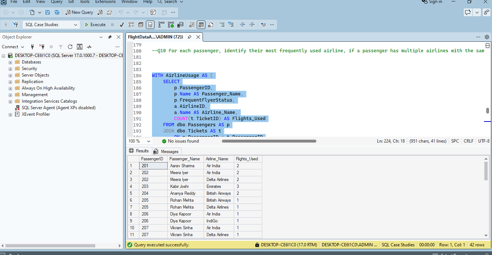

# Flight Data Analysis

## Project Overview
This project analyzes airline flight, passenger, airport, and ticket data using SQL Server. It explores airline performance, passenger behavior, and ticket revenue through business-focused SQL queries.

## Tools
- Microsoft SQL Server
- SQL Server Management Studio (SSMS)
- SQL

## Database Tables
- Airlines
- Airports
- Flights
- Passengers
- Tickets

## Business Questions
- Which airport has the most departures?
- Which airline sells the most tickets?
- Which airline generates the highest ticket revenue?
- Which flight has the highest ticket price on each route?
- Who is the highest-spending passenger in each frequent flyer status group?
- Which airline does each passenger use most frequently?

## SQL Skills Demonstrated
- JOINs
- Aggregate functions (`SUM`, `COUNT`, `MIN`, `MAX`)
- `GROUP BY`
- Common Table Expressions (CTEs)
- Window functions (`RANK`)
- Data analysis and business insight generation

## Project Files
- `FlightDataAnalysis.sql` — SQL queries used for the analysis

## Key Findings

- **Airline revenue:** Delta Airlines generated the highest total revenue, with 16 tickets sold and total revenue of 93,600.
- **Passenger spending:** The highest-spending passenger in the Silver frequent flyer group spent 26,000 across 4 tickets.
- **Passenger airline usage:** The analysis identifies each passenger’s most frequently used airline, including ties when multiple airlines have equal usage.

## Query Results

### Airline Revenue Analysis

### Passenger Airline Usage

### Highest Ticket Price by Route

### Passenger Spending Analysis

